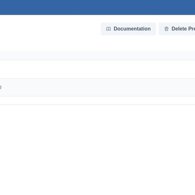
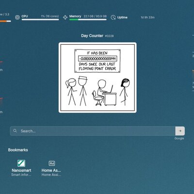
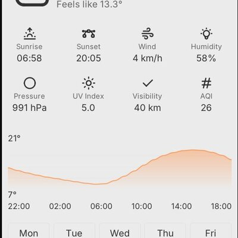

#  Dashi

Dashi is a self-hosted landing page and home dashboard with a visual editor,
and it can render any dashboard as a PNG for e-ink displays. Single binary, no
database: dashboards, themes and uploads are plain files on disk.

<p>
  <a href="zarf/sreenshots/editor_list.jpg"></a>
  <a href="zarf/sreenshots/editor.jpg"></a>
  <a href="zarf/sreenshots/dashboard.jpg"></a>
  <a href="zarf/sreenshots/e-ink.jpg"></a>
</p>

## Features

- Build multi-page dashboards in the browser by dragging widgets across a 12-column grid
- Show weather, stock and crypto prices, a clock, bookmarks, search, Swiss public transport, xkcd, system stats, notes and images
- Put a dashboard on an e-ink or ESP32 display as a PNG, dithered for black-and-white or 6-colour panels
- Style dashboards with themes: backgrounds, light and dark palettes, and uploadable font and icon packs
- Protect individual dashboards with a password
- Run it as a Home Assistant add-on

## Quick start

Download the zip or `.deb` for your platform (Linux, macOS or Windows) from the
[releases page](https://github.com/andresbott/dashi/releases/latest), then
start the server:

```sh
dashi start
```

Open <http://localhost:8088> to create dashboards in the editor. The read-only
viewer, for browsers and displays, is on <http://localhost:8087>. Configuration
and running as a service: [docs/running.md](docs/running.md).

### Home Assistant add-on

Add `https://github.com/andresbott/dashi` as an add-on repository
(Settings → Add-ons → Add-on store → ⋮ → Repositories), then install **Dashi**.
The editor opens from the Home Assistant sidebar. See
[ha-addon/DOCS.md](ha-addon/DOCS.md).

## Development

See [DEVELOPMENT.md](DEVELOPMENT.md).

## License

Licensed under the [GNU Affero General Public License v3.0](LICENSE).
